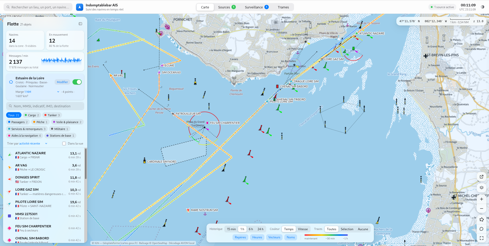

# Indomptable AIS




** Cette application est gratuite est open source**

**Suivi des navires en temps réel par AIS** : un tableau de bord dans le navigateur, avec une carte, les traces horodatées, une zone surveillée (estuaire de la Loire par défaut) et la surveillance de navires dans la durée. Les données peuvent venir de votre propre récepteur SDR (SDRplay RSP1), de réseaux ouverts ou communautaires, ou de fournisseurs commerciaux, terrestres comme satellites.

Le projet tient en **deux fichiers**, sans dépendance à installer :

| Fichier | Rôle |
|---|---|
| `Indomptable-ais.html` | L'application complète (interface, décodeur AIVDM, carte, sources), dans un seul fichier HTML. |
| `ais-relay.mjs` | Relais local Node.js (≥ 22, sans dépendance). Il sert l'application, fait le pont TCP/UDP/WebSocket vers le navigateur, passe les API qui refusent les appels directs et pilote AIS-catcher pour le récepteur SDR. |

> ⚠️ **Pas pour la navigation.** Les positions AIS sont déclarées par les navires et reçues sans garantie. Cet outil ne remplace ni un radar, ni une carte marine officielle, ni la veille visuelle.

---

## Sommaire

- [Fonctionnalités](#fonctionnalités)
- [Démarrage rapide](#démarrage-rapide)
- [Sources de données](#sources-de-données)
- [Récepteur SDR : SDRplay RSP1](#récepteur-sdr--sdrplay-rsp1)
- [AIS par satellite](#ais-par-satellite)
- [Zone surveillée](#zone-surveillée)
- [Onglet Surveillance](#onglet-surveillance)
- [Cartes et recherche de lieux](#cartes-et-recherche-de-lieux)
- [Le relais local](#le-relais-local)
- [Décodage AIVDM](#décodage-aivdm)
- [Confidentialité et sécurité](#confidentialité-et-sécurité)
- [Limites connues](#limites-connues)
- [Dépannage](#dépannage)
- [Développement](#développement)
- [Licence](#licence)
- [Sources et références](#sources-et-références)

---

## Fonctionnalités

**Carte**
- Navires orientés selon leur cap. Au zoom fort, la **coque est dessinée à l'échelle** à partir des dimensions AIS (A/B/C/D) et de l'antenne GNSS.
- **Traces colorées selon l'âge** (rouge = maintenant, bleu/violet = ancien) ou **selon la vitesse**, avec un **petit repère perpendiculaire à chaque position reçue**.
- Étiquettes horaires le long de la trace sélectionnée, vecteurs de route (position estimée à 6 min), noms des navires.
- **Survol d'une trace** : heure exacte locale et UTC (calée sur la seconde émise par le transpondeur), position en degrés-minutes, vitesse, route, cap, taux de giration, statut, précision, canal VHF et source. Pour le segment survolé : durée, distance, vitesse réellement calculée et relèvement. Un clic garde l'infobulle affichée.
- Aides à la navigation AIS dessinées avec les symboles du balisage IALA (cardinales, latérales, danger isolé, eaux saines, marques spéciales), y compris les AtoN virtuelles, avec les étiquettes `seamark:*` d'OpenSeaMap.
- Fonds de carte : Plan IGN et photographies aériennes (cartes.gouv.fr / Géoplateforme), carte marine Shom (expérimental), OpenStreetMap, plus la couche de balisage OpenSeaMap.
- La vue (centre et zoom) est retrouvée à la réouverture.

**Tableau de bord**
- Liste de la flotte : recherche par nom, MMSI, indicatif, IMO ou destination ; filtres par catégorie ; tri.
- Compteurs (navires, en mouvement, messages/min) avec courbe d'activité.
- **Fiche du navire** : identité, pavillon déduit du MMSI, type, dimensions et schéma de coque, voyage (destination, ETA, tirant d'eau), navigation, statistiques de trace, réception (types de messages, canaux A/B, sources, satellite ou terrestre), dernières trames brutes, liens MarineTraffic et VesselFinder, export **GPX** et **CSV**.

**Autres onglets**
- **Sources** : toutes les sources, activables en même temps et fusionnées par MMSI.
- **Surveillance** : historique complet et persistant des navires choisis.
- **Trames** : flux NMEA brut en direct et **atelier de décodage**, où l'on colle des trames pour les voir détaillées champ par champ.

**Interface** : style inspiré d'Apple, thème clair ou sombre (automatique ou forcé), raccourcis clavier, glisser-déposer d'un fichier NMEA sur la carte.

---

## Démarrage rapide

1. Installez **Node.js 22 ou plus récent**.
2. Placez `Indomptable-ais.html` et `ais-relay.mjs` **dans le même dossier**.
3. Lancez le relais :
   ```bash
   node ais-relay.mjs
   ```
4. Ouvrez **http://localhost:8787** dans votre navigateur.

Au premier lancement, un **simulateur** produit une flotte fictive dans l'estuaire de la Loire pour découvrir l'interface. Il s'arrête depuis l'onglet **Sources**.

> Ouvrir directement le fichier HTML (double-clic) fonctionne aussi. Les fonds IGN s'affichent, mais OpenStreetMap peut refuser ses cartes, et les sources qui passent par le relais exigent quand même que celui-ci tourne.

### Raccourcis clavier

| Touche | Action |
|---|---|
| `Ctrl/⌘ + K` | Recherche de lieu, de navire ou de coordonnées |
| `/` | Recherche dans la flotte |
| `1` `2` `3` `4` | Onglets Carte, Sources, Surveillance, Trames |
| `F` | Suivre le navire sélectionné |
| `Échap` | Fermer la fiche ou l'infobulle épinglée |
| `+` `−` et flèches | Zoom et déplacement de la carte |

---

## Sources de données

Plusieurs sources peuvent être actives en même temps. Leurs messages sont **fusionnés par MMSI** et **dédoublonnés**.

| Source | Couverture | Accès | Relais requis | Temps réel |
|---|---|---|---|---|
| **Simulateur AIVDM** | Estuaire de la Loire (fictif) | Intégré | Non | Oui |
| **Récepteur SDR — SDRplay RSP1** | Portée de votre antenne VHF | Votre matériel | Oui | Oui |
| **Flux NMEA (WebSocket)** | Votre récepteur ou un flux public TCP/UDP (ex. Kystverket, Norvège) | Variable | Selon le cas | Oui |
| **Digitraffic** | Finlande, mer Baltique | Gratuit, sans clé | Non | Oui |
| **AISStream.io** | Mondial (stations terrestres) | Clé gratuite | Oui | Oui |
| **AIS-catcher — réseau communautaire** | Mondial (stations bénévoles) | Clé réservée aux stations contributrices | Oui | Non (15 min, quota) |
| **Signal K** | Votre bateau et ses cibles AIS | Réseau local | Non | Oui |
| **AISHub** | Mondial | Échange de données | Oui | Non (≥ 1 min) |
| **VesselFinder API** | Mondial | Abonnement | Oui | Non |
| **MarineTraffic API** | Mondial (+ satellite selon contrat) | Abonnement | Oui | Non |
| **Spire Maritime — satellite** | Mondial (satellite + terrestre) | Abonnement | Oui | Non (1 à 10 min) |
| **Opérateurs satellites AIS** | Selon l'opérateur | Contrat | Oui | Selon contrat |
| **Fichier NMEA** | Enregistrement | Local | Non | Rejeu ×1 à ×60 ou instantané |

**À noter :**
- **AISStream** refuse les connexions directes depuis un navigateur ; le relais s'en charge. Par défaut, seule la zone surveillée est demandée.
- **MarineTraffic** : leurs conditions d'utilisation interdisent d'extraire les données du site web. Seule l'**API officielle** est utilisée. Le bouton « ouvrir ailleurs » de la carte ouvre la carte web MarineTraffic sur la vue en cours.
- **AIS-catcher (aiscatcher.org)** : la carte live n'est consultable que dans le navigateur. L'**API communautaire** est réservée aux stations qui alimentent le réseau depuis au moins deux semaines (voir [ci-dessous](#partager-son-récepteur-et-obtenir-une-clé-aiscatcherorg)).
- Les **clés et jetons** sont enregistrés uniquement dans le navigateur.

---

## Récepteur SDR : SDRplay RSP1

Cette source reçoit en direct les **deux canaux AIS internationaux** :

| Canal | Fréquence | Désignation |
|---|---|---|
| AIS 1 (A) | **161,975 MHz** | canal 87B |
| AIS 2 (B) | **162,025 MHz** | canal 88B |

Le navigateur ne peut pas piloter un SDR USB. Le relais lance donc **AIS-catcher** (décodeur libre compatible RSP1, RSP1A et RSPdx via l'API SDRplay 3.x) et transmet ses trames à l'application.

### Matériel et logiciels

1. Un **SDRplay RSP1** branché en USB, et une **antenne VHF marine** (accordée vers 162 MHz, placée le plus haut et le plus dégagée possible).
2. Le pilote **SDRplay API 3.x** ([sdrplay.com/api](https://www.sdrplay.com/api/)).
3. **AIS-catcher**, compilé avec la prise en charge SDRplay ([docs.aiscatcher.org](https://docs.aiscatcher.org/)).

### Utilisation

Dans **Sources → Récepteur SDR — SDRplay RSP1** :

- **Le relais lance AIS-catcher (recommandé)** : renseignez si besoin le numéro de série, l'**état LNA** (RSP1 : 0 à 3, 0 = gain maximal), la **réduction de gain IF** (20 à 59 dB), l'**AGC** et la **correction en ppm**.
- **AIS-catcher lancé à part** : choisissez UDP ou serveur TCP ; la commande à lancer s'affiche, prête à copier.

La carte de la source affiche le nombre de messages reçus sur chaque canal (utile pour régler l'antenne), la commande utilisée, le bouton **Lister les appareils SDR** et le journal d'AIS-catcher.

Exemple de commande produite :

```bash
AIS-catcher -d 1806001234 -gs lnastate 0 grdb 32 agc off -n
```

Si AIS-catcher n'est pas trouvé automatiquement :

```bash
node ais-relay.mjs --ais-catcher /chemin/vers/AIS-catcher
# ou : AIS_CATCHER=/chemin/vers/AIS-catcher node ais-relay.mjs
```

### Partager son récepteur et obtenir une clé aiscatcher.org

1. Créez votre station sur [aiscatcher.org](https://www.aiscatcher.org/addstation) et récupérez votre **clé de partage**.
2. Collez-la dans le champ **« Clé de partage aiscatcher.org »** de la source SDR. AIS-catcher est alors lancé avec `-X`, et la clé est masquée dans l'interface et le journal.
3. Après **deux semaines** de données réelles, demandez une **clé API communautaire** dans l'onglet *API* de votre station, puis collez-la dans la source **AIS-catcher — réseau communautaire**.

---

## AIS par satellite

L'AIS par satellite (S-AIS) **étend la couverture au large**, là où aucune antenne terrestre ne capte. Il **ne rend pas les positions plus exactes** : la position transmise reste celle du GNSS du navire (GPS, Galileo…). Près des côtes, et donc dans l'estuaire de la Loire, les récepteurs terrestres (votre RSP1, AISStream…) sont aussi précis et plus rapides.

Dans l'application, les positions reçues par satellite portent une pastille **« Satellite (S-AIS) »**.

| Opérateur | Satellites | Propriétaire | Accès dans Indomptable AIS |
|---|---|---|---|
| **Spire** (LEMUR-2) + **exactEarth** | Nanosatellites LEMUR-2 ; charges AIS exactEarth sur Iridium NEXT | Kpler (activité maritime rachetée en avril 2025 ; Spire avait racheté exactEarth en novembre 2021). Kpler possède aussi MarineTraffic | Source **Spire Maritime** (API GraphQL Maritime 2.0) |
| **ORBCOMM** | Constellation OG2 | Réseau de suivi des navires racheté par S&P Global | Source **Opérateurs satellites AIS** (flux NMEA TCP sous contrat) |
| **Kinéis** | Nanosatellites (suite du système Argos) avec récepteur AIS | Français | Idem, sous contrat |
| **AprizeSat** | Microsatellites | SpaceQuest / AAC Clyde Space | Idem, sous contrat |
| Karten Space, ISISpace (TRITON), OHB Italia (EAGLET), Aistech Space, HEAD Aerospace, Sternula (MARIOT), Sitronics (SITRO-AIS), Saab (Ymir) | Constellations récentes ou de démonstration | — | Flux NMEA TCP si l'opérateur en fournit un |

Aucun de ces opérateurs ne propose de flux gratuit. La source générique accepte un flux NMEA sur TCP (hôte, port et, si besoin, une ligne d'identification envoyée à la connexion), à régler avec les paramètres fournis par l'opérateur.

---

## Zone surveillée

Par défaut, l'application se concentre sur l'**estuaire de la Loire**, défini par un polygone de quatre points :

| # | Point | Latitude | Longitude |
|---|---|---|---|
| 1 | Pointe du Croisic | 47.2886 | −2.5364 |
| 2 | Prinquiau | 47.3631 | −2.0100 |
| 3 | Basse-Goulaine | 47.2161 | −1.4642 |
| 4 | Pointe de Noirmoutier (l'Herbaudière) | 47.0243 | −2.3033 |

Ce polygone couvre Saint-Nazaire, Montoir, Donges, Paimbœuf, Cordemais, Le Pellerin, Nantes, la baie de La Baule et Pornic. Une **marge** réglable (1 mille nautique par défaut) englobe aussi le port du Croisic et le bord de la baie de Bourgneuf.

- **Filtre :** l'interrupteur *Estuaire de la Loire* limite la carte, la liste et les compteurs aux navires de la zone.
- **Bouton Modifier :**
  - glisser un point sur la carte pour le déplacer ;
  - **double-clic** sur la carte pour ajouter un point (il s'insère sur le côté le plus proche) ;
  - une **recherche de lieu** pendant l'édition ajoute aussi le lieu comme point ;
  - chaque point peut être renommé, centré ou supprimé (3 points minimum) ;
  - le panneau affiche la surface et prévient si deux côtés se croisent.
- **Rétablir la zone par défaut** revient au polygone d'origine.
- La zone sert aussi aux requêtes d'AISStream, de MarineTraffic, de Spire et d'AIS-catcher.

---

## Onglet Surveillance

Un **clic sur un navire** (sur la carte ou dans la liste) l'ajoute à la surveillance. L'onglet affiche pour chaque navire :

- une **carte de toute sa trace** : début, arrêts, position actuelle, dégradé de l'ancien au récent ;
- **distance totale**, **temps en route**, nombre d'**arrêts**, **vitesse maximale**, position actuelle ;
- un **journal des déplacements** découpé en trajets et en arrêts (≥ 5 min). Un clic sur un trajet ou un arrêt cadre la carte dessus ;
- les **événements** : changements de statut, changements de destination, **entrées et sorties de zone** ;
- le **tableau de toutes les positions**, page par page ;
- l'export **GPX** et **CSV**.

L'historique est conservé dans le navigateur (IndexedDB, jusqu'à 100 000 positions par navire) et **survit à la fermeture**. Il ne s'enrichit que pendant que l'application est ouverte et reçoit le navire.

---

## Cartes et recherche de lieux

| Fond | Fournisseur | Remarque |
|---|---|---|
| **Plan IGN** (par défaut) | Géoplateforme IGN, comme cartes.gouv.fr | WMTS `GEOGRAPHICALGRIDSYSTEMS.PLANIGNV2`, en Web Mercator |
| Photographies aériennes | Géoplateforme IGN | `ORTHOIMAGERY.ORTHOPHOTOS` |
| Carte marine Shom | data.shom.fr | Expérimental : nom de couche non vérifié |
| OpenStreetMap | OSM | Peut refuser une page ouverte en `file://` |
| **Balisage OpenSeaMap** (couche) | OpenSeaMap | Bouées, balises, feux, chenaux |

La **barre de recherche** (en haut à gauche) interroge l'autocomplétion de la Géoplateforme (lieux, ports, adresses). Elle trouve aussi les navires connus (nom ou MMSI) et accepte les coordonnées (`48.38 -4.49` ou `48°22,8'N 4°29,4'W`).

---

## Le relais local

```bash
node ais-relay.mjs [--port 8787] [--host 127.0.0.1] [--allow-origin https://exemple.fr] [--ais-catcher /chemin/AIS-catcher]
```

| Point d'accès | Rôle |
|---|---|
| `GET /` | Sert `Indomptable-ais.html` |
| `GET /health` | État et version du relais |
| `WS /ws?target=wss://…` | Pont WebSocket → WebSocket (AISStream) |
| `WS /tcp?host=…&port=…[&login=…]` | Pont TCP NMEA → WebSocket |
| `WS /udp?port=…` | Écoute UDP NMEA → WebSocket |
| `WS /sdr?lnastate=…&grdb=…&agc=…&ppm=…&serial=…&share=…` | Lance AIS-catcher (SDR) et transmet les trames |
| `GET /sdr/list` | Liste les SDR détectés (`AIS-catcher -l`) |
| `GET/POST /proxy?url=…` | Transmet une requête aux API autorisées, en ajoutant les en-têtes CORS ; le jeton `Authorization` est relayé |

**Sécurité du relais**
- Écoute sur `127.0.0.1` par défaut.
- N'accepte que les origines locales (page ouverte en `file://` ou servie par le relais), plus celles ajoutées par `--allow-origin`.
- Le proxy HTTP et le pont WebSocket ne joignent que des **hôtes autorisés** (AISHub, VesselFinder, MarineTraffic, Digitraffic, Spire/Kpler, aiscatcher.org, AISStream).
- Les paramètres du SDR sont validés strictement avant le lancement d'AIS-catcher.

---

## Décodage AIVDM

Le décodeur est intégré à la page et suit la spécification ITU-R M.1371 telle que documentée par gpsd :

- types **1, 2, 3** (position classe A), **4 / 11** (station de base), **5** (statique et voyage), **9** (aéronef SAR), **18** (position classe B), **19** (classe B étendue), **21** (aide à la navigation), **24** A/B (statique classe B), **27** (longue portée) ;
- réassemblage des messages en plusieurs fragments, vérification de la somme de contrôle, **tag blocks NMEA 4.10** (`\c:…\` pour l'horodatage) ;
- décodage du taux de giration (formule 4,733 × √ROT), valeurs « non disponible » (lat 91°, lon 181°, SOG 102,3, COG 360, cap 511) ;
- **horodatage exact** : l'heure de réception est recalée sur la seconde UTC émise par le transpondeur ;
- pavillon déduit du MID (premiers chiffres du MMSI), nature de l'émetteur (navire, station côtière, AtoN, SART/MOB/EPIRB, aéronef SAR…) ;
- correspondance des types d'AtoN AIS avec les étiquettes `seamark:*` d'OpenSeaMap.

L'onglet **Trames** permet de coller n'importe quelle trame pour la voir détaillée champ par champ (exemples gpsd fournis).

---

## Confidentialité et sécurité

- Tout fonctionne **sur votre ordinateur**. Aucune donnée n'est envoyée ailleurs qu'aux sources que vous activez.
- Les clés et jetons (AISStream, Spire, MarineTraffic, aiscatcher.org…) sont stockés **uniquement dans le `localStorage` du navigateur**.
- La clé de partage aiscatcher.org est masquée dans l'interface et les journaux.
- L'historique de surveillance est stocké dans **IndexedDB**, dans ce navigateur uniquement.

---

## Limites connues

- **Formats non vérifiés en conditions réelles** : MarineTraffic (requête par zone), Spire (certains champs GraphQL), API communautaire aiscatcher.org (noms de champs, lus avec plusieurs variantes) et couche Shom. En cas d'écart, l'erreur renvoyée par le service s'affiche dans la carte de la source.
- **Quota aiscatcher.org** : 30 requêtes par heure, d'où une mise à jour toutes les 15 min.
- **Satellite** : couverture élargie, mais réception moins régulière qu'à terre.
- **Simulateur** : trajets approximatifs, qui peuvent mordre sur la côte. Chaque démarrage recrée un historique fictif, qui peut dédoubler une trace surveillée.
- **Données AIS** : saisies en partie à la main (destination, ETA, statut) et donc parfois fausses. Certains navires n'émettent pas ou coupent leur AIS.

---

## Dépannage

| Symptôme | Solution |
|---|---|
| Fond de carte vide | Essayer un autre fond (bouton *Calques*) ; ouvrir la page via `http://localhost:8787` plutôt qu'en `file://`. |
| « Relais injoignable » | Lancer `node ais-relay.mjs` ; vérifier l'adresse dans *Sources → Relais local → Tester*. |
| « AIS-catcher introuvable » | Installer AIS-catcher ou lancer le relais avec `--ais-catcher /chemin/…`. |
| SDR : aucun message | Vérifier l'antenne et le pilote SDRplay ; augmenter le gain (LNA 0, grdb plus bas) ; vérifier les compteurs des canaux A et B. |
| AISStream ne renvoie rien | Vérifier la clé ; il faut Node.js ≥ 22 pour le pont WebSocket. |
| « Quota horaire atteint » (aiscatcher.org) | La source reprend d'elle-même ; augmenter l'intervalle ou réduire le nombre de navires par requête. |
| Aucun navire dans la zone | Désactiver le filtre *Estuaire de la Loire* ou augmenter la marge. |

---

## Développement

Les sources sont découpées en modules, puis assemblées en un seul fichier HTML :

```
src/
  ais-core.js   décodeur / encodeur AIVDM, tables (statuts, types, MID…)
  map.js        moteur de carte Web Mercator (tuiles, zoom fluide, inertie)
  store.js      modèle des navires, traces, géodésie, formatage
  render.js     rendu canvas : traces, repères, coques, AtoN
  sim.js        simulateur (vraies trames !AIVDM)
  sources.js    catalogue des sources
  app.js        interface principale
  watch.js      recherche de lieux + surveillance (IndexedDB)
  zone.js       zone surveillée (polygone modifiable)
  index.html    gabarit et styles
build.py        assemble dist/Indomptable-ais.html
test/           tests du décodeur, du relais et de l'interface
```

```bash
python3 build.py                 # produit dist/Indomptable-ais.html
node test/core.test.js           # tests du décodeur (exemples gpsd + aller-retour)
node test/relay.test.mjs         # tests du relais (TCP, UDP, listes d'autorisation)
```

---

## Licence

À définir par l'auteur du dépôt (par exemple MIT). Les données et fonds de carte restent soumis aux conditions de leurs fournisseurs respectifs (voir ci-dessous) ; affichez leurs attributions.

---

## Sources et références

### Spécification AIS et décodage
- gpsd — *AIVDM/AIVDO protocol decoding* : <https://gpsd.gitlab.io/gpsd/AIVDM.html>
- UIT — Recommandation ITU-R M.1371 (spécification technique de l'AIS) : <https://www.itu.int/rec/R-REC-M.1371>

### Cartographie
- OpenStreetMap — Marine Mapping (balisage `seamark:*`) : <https://wiki.openstreetmap.org/wiki/FR:Marine_Mapping>
- OpenSeaMap : <https://www.openseamap.org>
- cartes.gouv.fr : <https://cartes.gouv.fr/explorer-les-cartes/>
- Géoplateforme IGN — service WMTS : <https://data.geopf.fr/wmts> (exemple OpenLayers : <https://openlayers.org/en/latest/examples/wmts-ign.html>)
- Géoplateforme IGN — services et usages : <https://geoservices.ign.fr/usages>
- API de géocodage et d'autocomplétion de la Géoplateforme : <https://www.data.gouv.fr/dataservices/api-geoplateforme-geocodage/>
- Shom — service WMTS : <https://services.data.shom.fr/support/en/node/8>
- CARTO (fonds OSM clair et sombre) : <https://carto.com/attributions>

### Sources de données AIS
- Digitraffic (Fintraffic) — AIS maritime : <https://www.digitraffic.fi/en/marine-traffic/>
- AISStream.io — documentation : <https://aisstream.io/documentation>
- Kystverket (Norvège) — accès aux données AIS : <https://www.kystverket.no/en/sea-transport-and-ports/ais/access-to-ais-data/>
- AISHub — API : <https://www.aishub.net/api>
- VesselFinder — API : <https://api.vesselfinder.com/docs/>
- MarineTraffic — documentation des services : <https://servicedocs.marinetraffic.com/>
- Kpler — conditions d'utilisation (MarineTraffic) : <https://www.kpler.com/company/terms-of-use>
- Signal K : <https://signalk.org>
- AIS-catcher — carte live : <https://www.aiscatcher.org/livemap>
- AIS-catcher — API communautaire : <https://www.aiscatcher.org/community-api>
- AIS-catcher — développeurs (API de station, MCP) : <https://www.aiscatcher.org/developers>

### Récepteur SDR
- AIS-catcher — documentation : <https://docs.aiscatcher.org/>
- AIS-catcher — réglages SDRplay (RSP1 / RSP1A / RSPdx) : <https://jvde-github.github.io/AIS-catcher-docs/configuration/input/sdrplay>
- AIS-catcher — ligne de commande : <https://jvde-github.github.io/AIS-catcher-docs/usage/cli/>
- AIS-catcher — sortie UDP : <https://jvde-github.github.io/AIS-catcher-docs/configuration/output/UDP/>
- SDRplay — API 3.x : <https://www.sdrplay.com/api/>

### AIS par satellite
- Spire Maritime : <https://spire.com/maritime/>
- Spire — FAQ Maritime 2.0 (GraphQL) : <https://faq.spire.com/>
- Spire Maritime Vessels API (exemple de requête par zone) : <https://apis.io/apis/spire-maritime/spire-maritime-vessels-api/>
- Orbital Radar — satellites de Spire : <https://orbitalradar.com/satellites/operator/spire>
- SpaceNexus — exactEarth : <https://spacenexus.us/company-profiles/exactearth>
- SpaceWar — S&P Global finalise le rachat du réseau de suivi des navires d'ORBCOMM : <https://www.spacewar.com/reports/SP_Global_finalizes_deal_for_ORBCOMM_satellite_vessel_tracking_network_999.html>

### Coordonnées des points de la zone
- Prinquiau (Wikipédia) : <https://en.wikipedia.org/wiki/Prinquiau>
- Basse-Goulaine (Wikipédia) : <https://en.wikipedia.org/wiki/Basse-Goulaine>
- Pointe du Croisic : <https://climbingaway.fr/en/climbing-areas/le-croisic>
- Pointe de l'Herbaudière (Noirmoutier) : <https://www.camping-car.com/aires/4902-camping-municipal-la-pointe/>

### Contexte
- Vendée Globe — suivi de la flotte avec MarineTraffic : <https://www.vendeeglobe.org/en/article/marinetraffic-backs-race-directions-247-fleet-surveillance>
- CNES — balises embarquées sur les voiliers du Vendée Globe : <https://cnes.fr/sites/default/files/2024-09/vendee-globe-balises.pdf>
